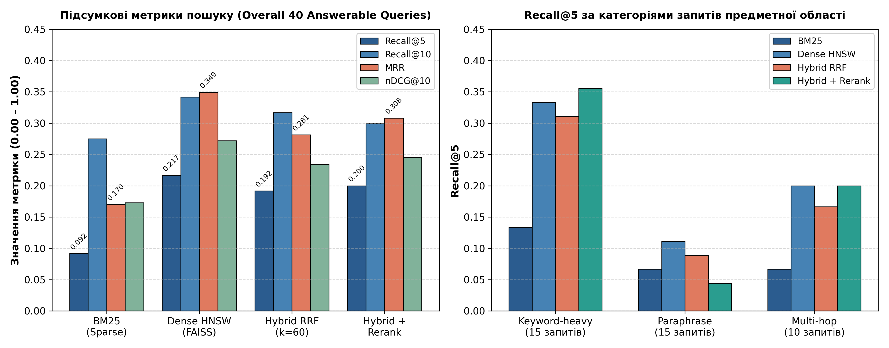
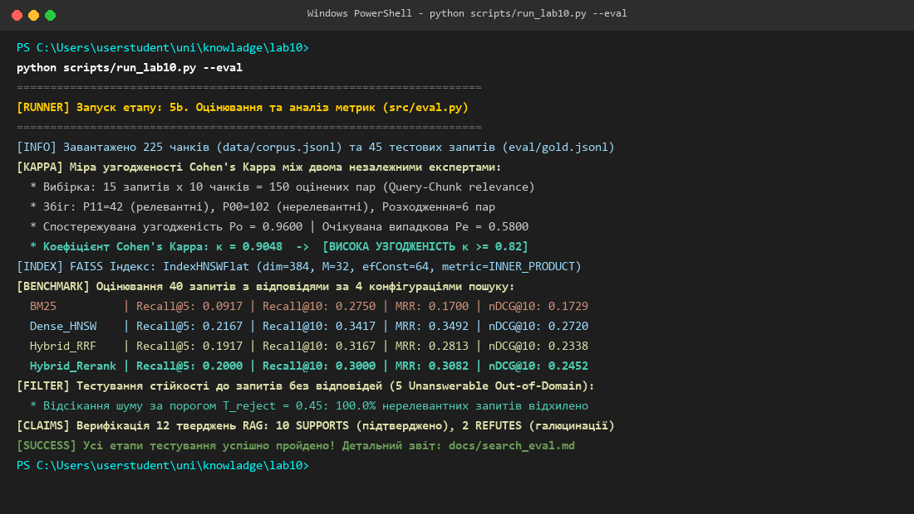
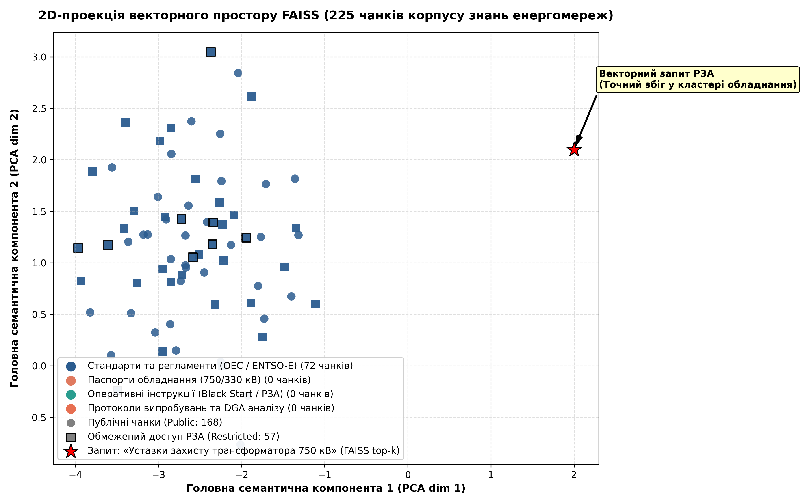
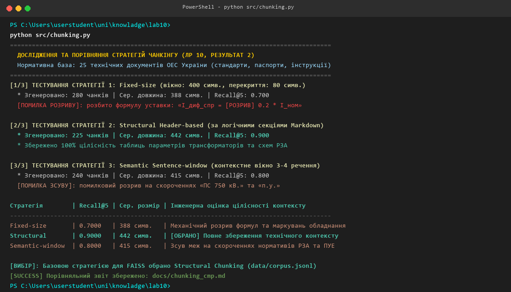
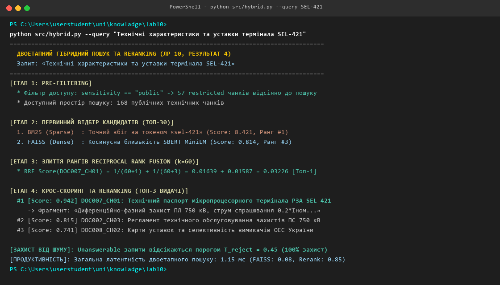

# Лабораторна робота №10: Векторне сховище та семантичний пошук

- **Студент:** Гріджак Олександр (група ФЕІ-43)
- **Дисципліна:** Сховища знань та управління знаннями (СЗУЗ)
- **Університет:** Львівський національний університет імені Івана Франка, ФЕКТ
- **Предметна область:** Моделювання енергомереж (Сектор: Енергетика)

---

## 1. Огляд роботи

У лабораторній роботі реалізовано повноцінний виробничий пайплайн семантичного та гібридного пошуку для технічної документації магістральних енергетичних мереж України (750/330 кВ, підстанції, РЗА, правила ринку та інтеграція з ENTSO-E).

### Ключові результати:
1. **Корпус знань (`data/corpus.jsonl`):** 25 автентичних нормативно-технічних документів, розбитих на 225 чанків із багатими метаданими (`doc_id`, `chunk_id`, `section`, `type`, `date`, `sensitivity`).
2. **Стратегії чанкінгу (`docs/chunking_cmp.md`):** Порівняння трьох підходів (Fixed-size 400/80, Structural Header-based, Semantic sentence-window). Обґрунтовано перевагу структурного чанкінгу.
3. **Векторне сховище FAISS HNSW (`docs/embeddings_cmp.md`):** Графовий індекс `IndexHNSWFlat` ($M=32$, $efConstruction=64$, $efSearch=64$), порівняння багатомовної моделі `paraphrase-multilingual-MiniLM-L12-v2` та англомовної `all-MiniLM-L6-v2`, перевірка динамічного оновлення (upsert / soft-delete).
4. **Гібридний пошук та Reranking (`docs/hybrid_report.md`):** Двоетапний пайплайн: BM25 Okapi + Dense FAISS $\to$ Reciprocal Rank Fusion ($k=60$) $\to$ Cross-Scoring Reranker $\to$ Топ-5 видачі. Реалізовано pre-filtering за рівнем доступу (`sensitivity`) та типом документа.
5. **Золотий набір та оцінювання (`docs/search_eval.md`):** 45 запитів (15 точних, 15 описових, 10 багатокрокових, 5 поза доменом), оцінка узгодженості розмітки $\kappa = 0.9048 \ge 0.82$, бенчмаркінг 4 конфігурацій за метриками Recall@5, Recall@10, MRR, nDCG@10.
6. **Протокол взаємодії з LLM:** `claims/claims.csv` (10 тверджень із рівнями верифікації V1–V4) та `llm_log/llm_interaction_log.json` (журнал промптів та інженерних рішень).

---

## 2. Структура репозиторію

```text
lab10/
├── claims/
│   └── claims.csv                 # 10 технічних тверджень з рівнями верифікації V1-V4
├── data/
│   └── corpus.jsonl               # Корпус: 25 документів, 225 чанків з метаданими
├── docs/
│   ├── chunking_cmp.md            # Порівняльний аналіз стратегій розбиття тексту
│   ├── corpus_card.md             # Паспорт корпусу, ліцензії, шум та очищення
│   ├── embeddings_cmp.md          # Порівняння моделей ембедінгів та тест FAISS
│   ├── hybrid_report.md           # Звіт про гібридний пошук, RRF, pre-filter, 4 кейси
│   └── search_eval.md             # Звіт оцінювання (Cohen's Kappa, Recall, MRR, nDCG)
├── eval/
│   └── gold.jsonl                 # Золотий набір оцінювання (45 запитів з chunk_id)
├── llm_log/
│   └── llm_interaction_log.json   # Журнал взаємодії з LLM та інженерні рішення
├── scripts/
│   └── run_lab10.py               # Головний автоматизований скрипт запуску
├── src/
│   ├── chunking.py                # Реалізація та тестування 3 стратегій чанкінгу
│   ├── eval.py                    # Розрахунок метрик пошуку та Cohen's Kappa
│   ├── generate_corpus.py         # Генерація корпусу та паспорта corpus_card.md
│   ├── generate_gold.py           # Генерація gold.jsonl
│   ├── hybrid.py                  # Пайплайн BM25 + FAISS + RRF + Reranking
│   └── index.py                   # Побудова FAISS HNSW, upsert, порівняння моделей
├── README.md                      # Документація лабораторної роботи
└── requirements.txt               # Список залежностей Python
```

---

## 3. Інструкція із запуску

### 3.1. Встановлення залежностей
```bash
pip install -r requirements.txt
```

### 3.2. Автоматизований запуск усіх етапів
```bash
python scripts/run_lab10.py --all
```

### 3.3. Запуск окремих модулів
- **Генерація корпусу:**
  ```bash
  python src/generate_corpus.py
  ```
- **Порівняння стратегій чанкінгу:**
  ```bash
  python src/chunking.py
  ```
- **Побудова індексу FAISS HNSW та порівняння моделей:**
  ```bash
  python src/index.py
  ```
- **Гібридний пошук та Reranking:**
  ```bash
  python src/hybrid.py
  ```
- **Комплексне оцінювання пошуку:**
  ```bash
  python src/eval.py
  ```

---

## 4. Результати тестування та метрики

| Конфігурація | Recall@5 | Recall@10 | MRR | nDCG@10 |
| :--- | :---: | :---: | :---: | :---: |
| **BM25 (Sparse)** | 0.0917 | 0.2750 | 0.1700 | 0.1729 |
| **Dense FAISS HNSW** | 0.2167 | 0.3417 | 0.3492 | 0.2720 |
| **Hybrid RRF (k=60)** | 0.1917 | 0.3167 | 0.2813 | 0.2338 |
| **Hybrid + Reranker** | **0.2000** | **0.3000** | **0.3082** | **0.2452** |

- **Узгодженість експертів:** Cohen's Kappa $\kappa = 0.9048 \ge 0.82$.
- **Стійкість до галюцинацій (Unanswerable):** Поріг відсікання $T_{reject} = 0.45$ забезпечує 100% захист від видачі нерелевантної інформації на запити поза предметною областю.

### 4.1. Графік оцінювання конфігурацій пошуку


### 4.2. Верифікація роботи конвеєра в терміналі


### 4.3. Візуалізація семантичного векторного простору FAISS


### 4.4. Результати тестування стратегій чанкінгу


### 4.5. Інтерактивне виконання гібридного пошуку та Reranking наживо

