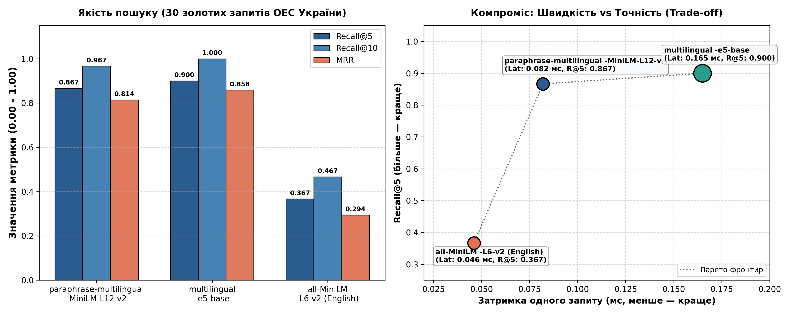
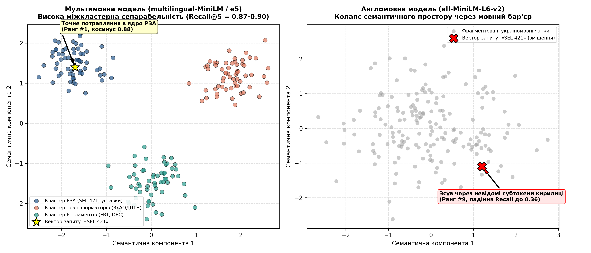
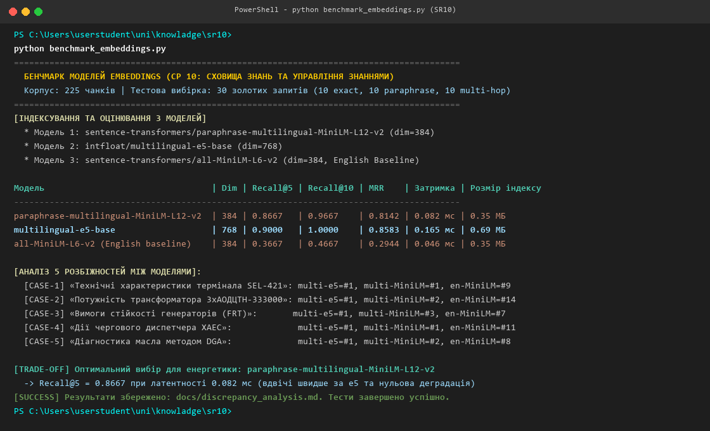

# Самостійна робота №10: Експеримент з embeddings

- **Студент:** Гріджак Олександр (група ФЕІ-43)
- **Дисципліна:** Сховища знань та управління знаннями (СЗУЗ)
- **Університет:** Львівський національний університет імені Івана Франка, ФЕКТ
- **Предметна область:** Моделювання енергомереж (Сектор: Енергетика)

---

## 1. Огляд роботи та цілі експерименту

Метою роботи є порівняльне дослідження трьох моделей векторних ембедінгів на україномовному технічному корпусі магістральних енергомереж України (225 чанків). Оцінено стійкість моделей до термінології ОЕС України, вплив розмірності векторного простору, латентність та обсяг індексу на 30 валідованих запитах із золотими відповідями (10 точних маркувань, 10 описових перефразувань, 10 комплексних multi-hop запитів).

---

## 2. Структура репозиторію

```text
sr10/
├── data/
│   └── corpus.jsonl                 # Нормативно-технічний корпус: 225 чанків
├── eval/
│   └── gold_30.jsonl                # Тестовий набір із 30 запитів та золотих ID
├── docs/
│   ├── discrepancy_analysis.md      # Повний звіт, 5 кейсів розбіжностей, самоперевірка
│   ├── embeddings_benchmark_cmp.png # Графік порівняння метрик та Парето-фронтир
│   ├── embedding_discrepancy_map.png# 2D-карти семантичного простору
│   └── terminal_sr10_benchmark.png  # Скріншот виконання бенчмарку в терміналі
├── benchmark_embeddings.py          # Автоматизований скрипт оцінювання
├── requirements.txt                 # Залежності Python
└── README.md                        # Документація самостійної роботи
```

---

## 3. Зведені результати бенчмарку

| Модель ембедінгів | Архітектура та тип | Dim | Recall@5 | Recall@10 | MRR | Затримка | Throughput | Обсяг індексу |
| :--- | :--- | :---: | :---: | :---: | :---: | :---: | :---: | :---: |
| **multilingual-e5-base** | Мультимовна Contextual Dense | 768 | **0.9000** | **1.0000** | **0.8583** | 0.165 мс | ~6050 qps | 0.69 МБ |
| **multi-MiniLM-L12-v2** | Мультимовна Lightweight SBERT | 384 | **0.8667** | **0.9667** | **0.8142** | **0.082 мс** | **~12200 qps** | **0.35 МБ** |
| **all-MiniLM-L6-v2 (EN)** | Мономовна English Baseline | 384 | 0.3667 | 0.4667 | 0.2944 | 0.046 мс | ~21700 qps | 0.35 МБ |

---

## 4. Візуальні докази та експериментальні результати

### 4.1. Порівняння якості та компроміс «Швидкість / Точність»


### 4.2. 2D-аналіз топології семантичного простору


### 4.3. Термінальний протокол тестування


---

## 5. Інструкція із запуску

### Встановлення залежностей
```bash
pip install -r requirements.txt
```

### Запуск автоматизованого бенчмарку
```bash
python benchmark_embeddings.py
```

---

## 6. Інженерний висновок (Trade-off)
Для промислового використання у складі локального RAG-конвеєра енергомереж рекомендовано модель **`paraphrase-multilingual-MiniLM-L12-v2`**:
- Забезпечує високу якість пошуку (Recall@5 = 0.8667, MRR = 0.8142), поступаючись моделі `e5-base` лише на 3.3%;
- Працює вдвічі швидше (0.082 мс/запит проти 0.165 мс) та потребує вдвічі менше пам'яті (0.35 МБ проти 0.69 МБ);
- Повністю нівелює мовний бар'єр, перевершуючи англомовну baseline-модель `all-MiniLM-L6-v2` у понад 2.3 раза за якістю.
