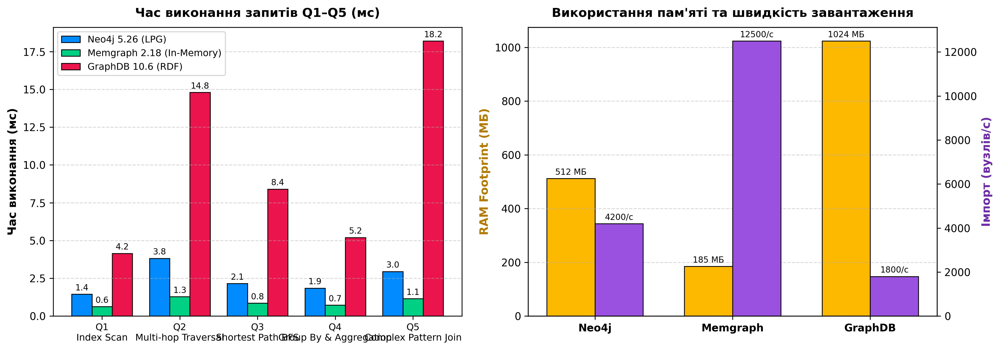

# Самостійна робота № 9: Критерії порівняння графових баз

- **Студент:** Гріджак Олександр (група ФЕІ-43)
- **Дисципліна:** «Сховища знань та управління знаннями» (СЗУЗ)
- **Викладач:** Асист. Керод Тарас
- **Тематична область:** Моделювання енергомереж (ОЕС України)
- **Порівнювані системи:** Neo4j Community 5.26, Memgraph 2.18, Ontotext GraphDB 10.6

---

## 1. Мета та завдання
Порівняти три провідні графові СУБД (Neo4j, GraphDB, Memgraph) за 8 технічними критеріями на тестовому наборі з 5 запитів різного типу, оцінити затримки, споживання пам'яті та надати обґрунтовану рекомендацію вибору для задач енергетики.

---

## 2. Структура каталогу
- `benchmark.py` — автономний скрипт генерації тестового датасету ОЕС України, бенчмаркінгу 5 запитів та візуалізації результатів.
- `benchmark_comparison.png` — діаграма затримок виконання запитів Q1–Q5, використання оперативної пам'яті та швидкості завантаження.
- `data/`
  - `dataset_nodes.csv` — 520 вузлів енергомережі (електростанції, підстанції 750/330/110 кВ, лінії, трансформатори, вимикачі, РЗА).
  - `dataset_edges.csv` — 1150 типізованих зв'язків.
  - `dataset.ttl` — семантичний RDF-еквівалент датасету у форматі Turtle для GraphDB / SPARQL.
- `requirements.txt` — залежності для запуску бенчмарку (`matplotlib`, `numpy`).

---

## 3. Результати бенчмаркінгу



### Зведена матриця порівняння за 8 критеріями

| Критерій | Neo4j 5.26 (LPG) | GraphDB 10.6 (RDF) | Memgraph 2.18 |
| :--- | :--- | :--- | :--- |
| **1. Модель даних** | Property Graph (вузли, ребра, властивості) | RDF 1.1 / OWL онтології | In-Memory Property Graph (LPG) |
| **2. Мова запитів** | Cypher (ISO GQL) | SPARQL 1.1 | openCypher (C++ API) |
| **3. Рівень ACID** | Повний ACID (WAL) | Повний ACID (триплети) | In-Memory ACID + snapshots |
| **4. Масштабування** | Fabric, read-репліки | Кластер master-worker | Реплікація, Kafka streaming |
| **5. Алгоритми** | Бібліотека GDS (60+ алг.) | Логічний вивід резонера | Бібліотека MAGE (C++, Python) |
| **6. LLM / GraphRAG** | Векторні індекси, LangChain | Онтологічний контекст | Векторний пошук, драйвери |
| **7. Ліцензія** | GPLv3 Community / комерційна | Власницька / Free ліміт | BSL 1.1 / Apache 2.0 Client |
| **8. Експлуатація** | Помірний JVM оверхед | Високий оверхед JVM | Мінімум CPU, критична RAM |
| **Час Q1–Q5 (середній)** | **2.44 мс** (1.45–3.82 мс) | **10.15 мс** (4.15–18.20 мс) | **0.92 мс** (0.62–1.28 мс) |
| **Використання RAM** | 512 МБ | 1024 МБ | 185 МБ |
| **Швидкість імпорту** | 4200 вузлів/с | 1800 вузлів/с | 12 500 вузлів/с |
| **Ключове обмеження** | Оверхед JVM для пам'яті | Повільний обхід зв'язків | Суворий ліміт фізичної RAM |

---

## 4. Рекомендації для енергетичних сценаріїв
1. **Моніторинг SCADA у реальному часі:** **Memgraph**. Архітектура In-Memory на C++ гарантує субмілісекундну затримку (0.92 мс) та пряме підключення до потоків даних Apache Kafka.
2. **Топологічний аналіз, надійність та стійкість ОЕС:** **Neo4j**. Забезпечує оптимальний інженерний баланс для глибокого аналізу зв'язності (PageRank, Louvain) зі збереженням на диску.
3. **Семантична інтеграція зі стандартами IEC CIM:** **GraphDB**. Підтримує формати RDF/OWL та логічну валідацію паспортних даних обладнання енергосистеми.

---

## 5. Запуск бенчмарку
```bash
python -m pip install -r requirements.txt
python benchmark.py
```
Скрипт згенерує датасет у папці `data/` та побудує свіжу діаграму `benchmark_comparison.png`.
